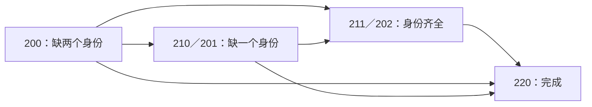

# 六大类的完整结构设计与分层计算方案

2026-11-03，日本时间。本文覆盖220／211／202／210／201／200，判断大类作为上层组织的计算收益。本轮只做设计和独立结构覆盖检查，不修改线上求解器。主指标沿用[操作成功率与成功路径FP期望](metric-revision-2026-11-03.md)，门槛15%／100FP。

## 1. 推荐的组织方式

采用“大类选模板、具体结构算转移、公共收尾复用”的组合。一次请求只展开实际入口能到达的结构，不预先算遍六类所有状态，也不把六类写成互不复用的六套求解器。

不强制200→202→220。200可以先取得一个目标进入210／201，取得第二个目标后进入211／202，救赎也可以直接进入220。正确的中间里程碑是“两个目标身份都已取得”，包含211、202以及已完成的220；202仅是其中一种。



图示为主干模板的里程碑，边可包含一个完整宏或预先声明的组合，并非全部原子状态转移表。

六个类别之间也不构成原子操作层面的无环图：浩劫会使210与201、211与202转换，救赎还可能丢掉已取得的身份。主干模板可以按身份获取里程碑前进，宏内部回退和循环仍由完整退出核处理，不能仅因类别倒退就剪枝。

大类不能独自作为Markov状态。例如同属210、三普通栏、A/B都为前缀：若空前缀可直接补B；若两前缀已满、空的是后缀则不能。类别相同但合法动作、NG风险和FP需求不同。用于计算的节点必须附带下述结构。

## 2. 完备分类的范围与字段

当前主场景为两个不同普通目标A/B各恰好T7、不设roll目标、恰好两个普通未封印T7。普通槽最多2前2后；普通封印和额外槽另存。定义r为正确T7数量，c为非T7普通槽中的正确目标数量，则0≤r≤2、0≤c≤2−r，恰有六组，分别对应六大类。

每个计算入口保留：

1. 普通占用数、空槽前后缀位置。
2. A/B的侧别、是否已存在及实际tier；A/B各只计一次。
3. 每个无关词缀的side、tier、原生顺序及后续动作资格。
4. 封印槽是否占用及占用ID；缺失普通目标已被封印时，不能把它视作可重新添加的空缺。
5. T6数量及位置；T6也参与救赎，不能笼统视作不会被重抽的低阶。
6. 底材／职业池、角色等级、保护、允许动作、模型版本。roll如加入则扩展相关状态，不套用无roll压缩证明。

占用数的全部分区为220(2/3/4)、211(3/4)、202(4)、210(2/3/4)、201(3/4)、200(2/3/4)。空槽侧别、目标侧别、无关tier、封印状态按正交字段完整划分，不靠手列几个tier串替代。

基础普通四槽结构的独立穷举和范围局限见[覆盖审计](research/strategy-classification-audit.md)及[结构化结果](../research/strategy-classification-coverage.json)。这证明入口结构分类覆盖，不证明任意长度路线的全局最优。

在四种A／B前后缀配置下，独立枚举检验8580个带位置／阶数的结构代表，六类计数分别为588／2016／432／2352／2016／1176；与独立组合公式一致。封印ID、实际词库资格和特殊类型不包含在这个数字中，另用资格边界校验。

实际入口先检查制作资格和目标可达限制。当前动作集不能创造新的普通T7，因此不足两个可用普通T7不能完成本目标；三个／四个T7则另列3xx／4xx类，不硬塞进本轮六类。特殊词缀和封印资格仍经[原子规则](../src/core/rules.ts)逐项判断。

## 3. 共同模块：收尾、取得一个身份、取得两个身份

### 收尾

入口是A/B已存在，对应211／202或220。220立即结束；211若只有三条普通词缀先合法补满；其余进入预先声明的最终浩劫宏。

对于合法四栏、恰好两个T7、目标只要求A/B各T7且无硬保护冲突的直接浩劫模板：未达标入口的两个非T7阶数相同，则单发1/5；不同则2/11。重复至成功的平均次数分别5和5.5，操作成功率为1。费用按相应符文核计算，211／202相同结构可以共享此收尾结果，无须分别展开整条随机过程。[原生浩劫与排列证据](research/affix-actions-audit.md)

这是公共直接收尾基线，不据此无证宣称所有额外升级／roll处理都劣势。需要改善阶数或roll的收尾变体须另列并比较；不把初始身份齐全当作全游戏最优性证明。

### 取得一个缺失身份

入口为210／201，或200取得第一目标后的出口。对当前动作集合，缺失ID只能来自定向添加、混沌身份重抽、救赎身份重抽；封印／剥离用于开槽，浩劫用于调整阶数和资格。机制依据为[当前动作审计](research/affix-actions-audit.md)。按以下决策表覆盖：

| 子条件 | 必须讨论的候选与前置 |
|---|---|
| 缺失目标所在侧有空槽 | 直接添加；添加后若不足四栏，选择合法填充，再调用收尾 |
| 该侧无空槽、封印槽可用 | 封该侧合法垃圾；或先浩劫把可封tier搬到垃圾上。分别保留可达T1～T4及相关对象，不强定一个tier全局最优 |
| 该侧无空槽、可剥离垃圾 | 剥离预先允许的集合，失手NG，再添加；垃圾当前承载必要T7时先研究浩劫搬走T7，不允许保留导致T7不足的分支 |
| 该侧有可混沌对象 | 在实际可升级窗口内寻找缺失身份；预先声明T5未中是NG还是进入一个明确补救模板，不能暗中追加补救 |
| 救赎能触及目标侧 | 评估救赎停止条件及所有被重抽对象。已有目标若在T6／T7会被重抽；可先浩劫将其移到≤T5，或把允许身份暂失的过程包进完整救赎宏 |
| 目前不具备所需前置 | 只有能明确打开下一步的填充／浩劫／腾位准备才生成；不能把当前无合法第一步等同于全路线无解 |

缺失目标在封印槽中的同ID、目标无合法碎片、相关普通对象不可封／不可剥、角色等级不足或明确保护冲突，分别给对应资格原因。只影响某一种方法的限制不删除另外两种身份获取方法。

### 取得两个缺失身份

入口200。既保留“取得一个→取得剩下一个→收尾”的组合，也保留一次完整宏取得两个或直接达标的路径。两个目标的添加顺序、开槽侧别与可接受垃圾集合均按实际结构生成。

## 4. 六个大类逐一闭合

### 220

A/B已经各T7。无论普通栏为2／3／4条，直接完成，成功率100%、需求0。无需为了使用浩劫去补满空栏。

### 211

三个普通槽：补一个不覆盖A/B的合法填充，再收尾；四个普通槽：直接收尾。填充的暴击、额外加阶、等级阻挡分支仍进入联合核。只有收尾中相关的填充ID等价时才能用代表ID，不全量枚举词库也不任意选择一个未经证明的垃圾。

### 202

普通四栏必满。A/B非T7阶数相同／不同都直接调用公共收尾核，目标前后缀侧别不限制浩劫搬阶。T6可作为非T7目标，但没有必要先救赎改变已获得身份。

### 210

已有目标A在T7，B缺失。2／3／4普通槽分别对应两个／一个／零空栏：

- 有B侧空栏：添加B；若仍不足四栏，补填充后收尾。
- 有空栏但都不在B侧：优先检查能否先填满四栏，再浩劫搬低阶到B侧垃圾、封印或剥离；不能直接对三栏用浩劫。
- 满四栏：调用取得一个身份的全部方法；封印槽空／已占用分别判断。

A身份已有价值，但A当前T7不是必须永久锁住的属性。保护A身份的准备可以暂降其tier。反复救赎可能重抽A，不先验视作保住A；若整体宏允许丢失再取得，完整评价成本，不擅自新增NG条件或全局禁用。

### 201

已有目标A在T1～T6，B缺失。三栏时按唯一空槽是否在B侧区分；四栏时调用取得一个身份模块。

所有方法保留“A是目标”这一角色，不把它当垃圾封掉。T1若在A上，可先浩劫搬给其他垃圾再开槽。已有A≤T5时纯救赎不会直接重抽它；A=T6时会，须另走准备或完整回退宏。该区别不能被201标签掩盖。

### 200：两个空栏

- 空槽可同时容纳A/B：两种合法添加顺序分别生成，补齐后收尾。
- 只能先容纳一个目标：先补该目标，若只有三栏则加合法填充，随后复用取得一个模块。
- 两目标都无法直接添加：典型为两条T7占满目标共同侧、两空槽在另一侧。先补垃圾到四栏，再浩劫调整；同时保留救赎等不需要先开空位的方法。

### 200：一个空栏

- 空位可放至少一个目标：先补可放目标，再复用取得一个模块。原垃圾按T1、T2～T4、T5～T6分别保留，补词后的暴击可能改变最低可用tier。
- 空位不能放任一目标：先考虑合法填充后浩劫腾位，或直接采用身份重抽方法。
- 7710是原垃圾T1的子类；首个目标可A/B互换，封印前检查T1及侧别。不得把7720～7760自动套成同一条100%封T1路线。

### 200：普通四栏已满

按目标侧别与垃圾分布，覆盖以下入口族；每族仍要逐动作检查实际资格与是否保留至少两个T7：

1. **直接开两个位置**：双剥离；封印后剥离；剥离后封印。开出的侧别必须容纳A/B，必要时先浩劫把低阶搬到将要删除／封印的垃圾上。
2. **开一个位置后补入目标**：剥离→补A→准备→封印或再剥离→补B；封印→补A→剥离→补B。补词可产生新的低阶，但其暴击分支不能假定总留下T1；封印最多一个普通槽。
3. **混沌取得身份**：分别考虑取得任一个后复用缺一条模块、或两个低阶窗口先后获取A/B。错侧的低阶先由浩劫调整。窗口耗尽的NG／补救必须预先声明。
4. **救赎取得身份**：分别考虑首次获得任一目标、取得两个目标身份、两个目标均T7等完整停止谓词；同样检查额外T6是否会被处理。只一发未双中即NG的候选按已证上界过滤，但不能拿该上界过滤重复宏或单中后补词的路线。
5. **多阶段身份获取**：第一阶段获A后，浩劫将A移至≤T5并使缺失目标侧保留可救赎位置，再第二阶段找B，最后收尾；也保留不同获取机制的有目的组合。不能无依据限定救赎最多一个阶段。

这不是宣称以上几条手写序列穷尽所有控制器。设计上的完备要求是：每个结构叶子都检查三种身份来源与两种开槽方式，以及这些方法明确需要的准备；路线范围由可审阅的模板语法声明。没有独立证明时，不将某条未列出的任意长循环称为被支配。

## 4.1 将分区变成有限、可审阅的模板语法

按“缺零个／一个／两个目标身份”选择组合规则。取得一个身份的参数来自两个目标角色、两种侧别、当前最多四个对象的允许集合、实际可用的封印tier及重抽停止谓词，不枚举任意12个宏的排列。

封印和剥离失败立即NG。混沌窗口用尽不是原生装备破坏：模板必须明确选择在此NG、尝试另一合法窗口，或转入既定的腾位／救赎后缀。如果允许“浩劫恢复低阶窗口再混沌”，将它列为单独的有明确循环／退出条件的复合宏，求其吸收核；不随意截断循环，也不默默忽略这种组合。

外层记录模板阶段，内层循环折进宏核。大类编号不需要单向变化，也不能代替阶段控制。分类完备、每个方法族都被检查、给定模板语法搜索完成、全游戏任意路线最优，是四种不同承诺，分别验收。

## 5. 宏模型怎样拼接，而不是只拼平均数

宏对入口结构i返回每个出口j的概率K(i,j)，以及该次宏FP需求乘出口事件的首矩R(i,j)。失败出口独立吸收；已完成出口不再制作。

若前缀到入口i的质量为p(i)，累计FP首矩为u(i)，拼接为：

```text
p'(j) = Σi p(i) K(i,j)
u'(j) = Σi [u(i) K(i,j) + p(i) R(i,j)]
```

最终操作成功率为成功出口质量之和；成功路径FP期望为成功出口首矩和除以成功质量。这样保留哪一种随机结果花了多少FP，而不携带0～63余额轴或完整花费分布。

上层选一条完整模板，模板内部固定条件分支预先声明。不能对每个随机出口重新挑独立最优后缀，再将这个自适应包络称为一条固定路线。公共缓存保存宏核／具体收尾结果；不同成功率—FP权衡保留Pareto候选，不能只给整个202或201缓存一个“最优平均值”。

## 6. 具体压缩与性能收益

- 移除旧主评分的FP预算轴；搜索只保留概率和FP首矩。分位数／有限FP曲线若保留，在选中路线之后另外计算。
- 220为常数结果；合法四栏211／202的直接最终浩劫可按两个非T7阶数相同／不同共用终局类型。
- 准备浩劫保留必要的实际出口，常见双T7只有6／12布局，不展开每次重试。
- 救赎在符合等价条件的阶段内部按侧别、目标标记、制作权重压缩。研究手套例342具体身份状态压为33状态；接后续宏时还要保留可封／可剥／等级等差异，不能盲目用一个代表替代所有垃圾。[独立核对](research/redemption-intrinsic.md)
- 相同前缀、宏核和收尾核按版本／上下文缓存，跨210／201／200复用。普通与冰在新口径共用状态图、费用按当前冰30%保留系数调整；血影响普通制作暴击，相关阶段独立处理。
- 只对实际请求按需展开。离线枚举用于覆盖验证，不把所有结构预先塞进每次浏览器求解。

宏层组织符合多步操作作为规划动作的通用思想，本项目仍保留决定实际转移的具体结构。[Sutton／Precup／Singh原始论文](https://www.sciencedirect.com/science/article/pii/S0004370299000521)

## 7. 剪枝和验证

资格错误、阶段无法退出、必要T7不足分别报告；操作成功率上界低于15%、最终成功条件FP下界超过100时记录已算阶段并“已放弃”。前缀成功条件均值不能直接当作整路线均值；细节沿用[门槛数学要求](metric-revision-2026-11-03.md)。

合并前缀至少要求完整出口概率分布和未来可用动作相同；若一条前缀逐状态累计FP首矩更高，可在相应共同后缀范围内删除。仅平均FP较高、类别编号较低或当前正确T7较少不构成安全剪枝。

验收分三层：

1. **结构覆盖**：六类及每种槽位／阶数／目标侧别基础结构均有分区；封印ID、特殊词缀、等级／保护另外构造资格边界。
2. **策略覆盖**：每个叶子对三种身份来源、两种开槽方式和准备前置都有生成或明确不适用原因；与小规模完整模板枚举对照。此处声明的是模板范围，不冒称任意玩家控制器全局最优。
3. **性能与数值**：同一新指标、同一候选范围，比较无缓存、公共收尾缓存、宏压缩及安全剪枝的结果和节点／耗时／内存。单列少算候选范围带来的收益，避免将目标改变或缩小范围冒充等价算法加速。

实现顺序：先收尾模块，再取得一个身份模块，最后取得两个身份的组合层；六类是入口路由和解释结构，共用同一套规则及求值模块。
